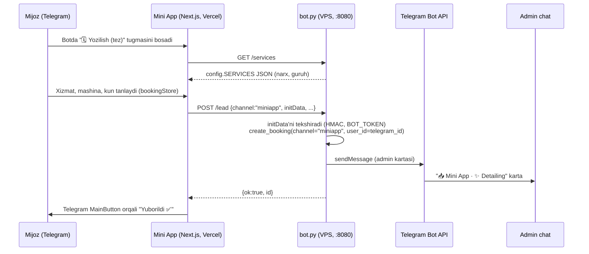

# Automaximus — Telegram Mini App arxitekturasi

Bu fayl sizning haqiqiy loyihangizga (`bot/`, `sayt/`, `dizayn-manba/`) moslab tuzilgan. Maqsad —
`bot/README.md` dagi "Keyingi bosqich: Mini App" bandini amalga oshirish: botni bosganda ochiladigan,
landing sahifa bilan bir xil ko'rinishdagi **"Narx kalkulyatori va yozilish"** oynasi.

## 1. Hozirgi holat (o'zgarmaydi)

```
automaximus detailin/
├── sayt/            statik landing (index.html, logo.html) — mijoz birinchi marta ko'radi
├── bot/             Python bot + SQLite + POST /lead (sayt formasidan so'rov qabul qiladi)
└── dizayn-manba/    Claude Design manba fayllari (saytni tahrirlash uchun)
```

- `bot/bot.py` — Telegram long-polling + `ThreadingHTTPServer` bitta jarayonda ishlaydi.
- Mijoz ma'lumotlari: `users`, `sessions` (yozilish bosqichi), `bookings`, `reminders` — SQLite.
- Sayt faqat formani `POST {BOT_SERVER_URL}/lead` ga yuboradi (`sayt/support.js`), bot admin chatiga karta yuboradi.

**Muhim qoida: bot/sayt arxitekturasiga tegmaymiz.** Mini App — bularga qo'shiladigan **uchinchi qatlam**, xizmat (`SERVICES`), narx va yozilish mantiqini botdan oladi, takrorlamaydi.

## 2. Nega Next.js emas, "Next.js'siz Next.js tuzilishi"

Siz yuborgan namuna (pizza do'koni uchun) — klassik Telegram Mini App skeleti. Avtomaximusga moslab, lekin bitta farq bilan:

| Pizza namunasi | Avtomaximus versiyasi | Sabab |
|---|---|---|
| `useCart.ts` | `useBooking.ts` | Savat emas — 5 bosqichli yozilish (xizmat → mashina → kun → telefon → tasdiq), xuddi `bot.py`dagi `BOOKING_STATES` bilan bir xil |
| `cartStore.ts` | `bookingStore.ts` | Bitta buyurtma davomida saqlanadigan holat, savat emas |
| `api.ts` → o'z backendi | `api.ts` → **mavjud `bot.py` HTTP serveri** (`/lead`, yangi `/services`) | Backend allaqachon bor — PHP/Node yozish shart emas |
| Mahsulotlar bazadan | Xizmatlar `config.py SERVICES`dan | Bitta joyda narx — bot va Mini App bir xil ro'yxatni ko'radi |

Shuning uchun **yangi backend yozilmaydi** — faqat `bot.py`ga 2 kichik qo'shimcha kiritiladi (3-bo'lim).

## 3. Mini App papka tuzilishi

`mini-app/` — `sayt/` va `bot/` bilan bir qavatda, alohida Next.js loyihasi:

```
automaximus detailin/
└── mini-app/
    ├── src/
    │   ├── app/
    │   │   ├── layout.tsx              # Telegram SDK skripti, shrift, TelegramProvider
    │   │   ├── page.tsx                 # Bosh oyna: 🛞 Do'kon / ✨ Detailing tanlash
    │   │   └── booking/
    │   │       └── page.tsx             # Yozilish wizard (bot.py bosqichlari bilan bir xil)
    │   ├── components/
    │   │   ├── ui/
    │   │   │   └── Chip.tsx             # tanlanadigan qator (xizmat, kun)
    │   │   └── features/
    │   │       ├── CategoryTabs.tsx     # Do'kon / Detailing
    │   │       ├── ServiceCard.tsx      # bitta xizmat/mahsulot, narx bilan (✅ tanlangan)
    │   │       └── BookingSummary.tsx   # "Tekshiring" ekrani — bot summary_text() bilan bir xil
    │   │   # components/layout/Header.tsx, MainButton.tsx — 7-bo'limdagi keyingi qadam;
    │   │   # hozir orqaga/davom tugmalari oddiy <button>, Telegram native BackButton/MainButton emas
    │   ├── hooks/
    │   │   ├── useTelegram.ts           # window.Telegram.WebApp: initData, user, theme, haptics
    │   │   └── useBooking.ts            # wizard bosqichini store bilan boshqaradi
    │   ├── lib/
    │   │   ├── api.ts                   # fetch(`${BOT_API_URL}/services`), fetch(`/lead`)
    │   │   ├── utils.ts                 # narx formatlash ("180 000 so'm"), telefon validatsiya
    │   │   └── constants.ts             # BOT_API_URL, GROUP_TITLES (config.py bilan bir xil matn)
    │   ├── providers/
    │   │   └── TelegramProvider.tsx     # SDK yuklanguncha skeleton, initData'ni context'ga beradi
    │   ├── store/
    │   │   └── bookingStore.ts          # Zustand: services[], car, day, phone — bot sessiyasiga mos
    │   └── styles/
    │       └── globals.css              # sayt/index.html bilan bir xil rang: #0E0E10, #D7182A
    ├── public/
    │   └── logo.png                    # dizayn-manba/Logo.dc.html'dan eksport
    ├── .env.local.example               # NEXT_PUBLIC_BOT_API_URL=https://bot.automaximus.uz
    ├── next.config.mjs
    ├── package.json
    └── tsconfig.json
```

### Nega shu fayllar aynan shunday

- **`page.tsx` ikkiga bo'lingan emas** (bosh + booking) — chunki Telegram Mini App'da sahifalar orasida
  o'tish `BackButton`/`MainButton` orqali boshqariladi, pizza namunasidagi bitta ro'yxat sahifasi bu yerda ikkita bosqichga aylandi.
- **`useCart` yo'q** — Automaximusda "savat" tushunchasi yo'q, bitta vizitga bir nechta xizmat tanlanadi (bot.py `services_kb`dagi ✅ belgisi bilan bir xil UX).
- **`TelegramProvider`** — pizza namunasida ham bor, lekin bu yerda **majburiy**: Mini App Telegram ichida ochiladi, `initData` orqali foydalanuvchi ID'si keladi — shu orqali yozilish to'g'ridan-to'g'ri o'sha Telegram foydalanuvchisiga bog'lanadi (bot orqali kelgandagidek, referal va eslatmalar ham ishlaydi).

## 4. Ma'lumot oqimi (data flow)



## 5. `bot.py`ga qo'shiladigan 2 narsa (mavjud kodga tegmasdan)

1. **`GET /services`** — `config.SERVICES` + `GROUP_TITLES`ni JSON qilib qaytaradi. Shunda narxlar
   ikki joyda (bot va Mini App) qo'lda yozilmaydi — bitta manba: `config.py`.
2. **`POST /lead`ga `channel` va `initData`** — hozir doim `channel="site"`. Mini App'dan kelganda
   `channel="miniapp"` va Telegram `initData`sini HMAC bilan tekshirib, `user_id`ni haqiqiy Telegram
   ID'siga bog'laymiz (shunda referal/eslatmalar bot orqali kelganidek ishlaydi).

Bu ikkisini men hozir kodga qo'shib qo'ydim — pastda.

## 6. Joylashtirish (deployment)

> To'liq qadamlar — [DEPLOYMENT.md](DEPLOYMENT.md)da. Hozirgi holat: Mini App Vercel'da jonli —
> **https://mini-app-pearl-five.vercel.app** (hali bot backendga ulanmagan, xizmatlar ro'yxati bo'sh ko'rinadi — bu kutilgan holat).


- `sayt/` — o'zgarmaydi, Netlify/statik joyda turadi.
- `bot/` — o'zgarmaydi, VPS'da `avtomaximus-bot.service` orqali ishlaydi, `:8080`ni Nginx/Caddy orqali `https://bot.automaximus.uz` qilib ochadi (README'da aytilgan).
- `mini-app/` — **Vercel'ga** (`vercel.com`, bepul tier) deploy qilinadi, `NEXT_PUBLIC_BOT_API_URL=https://bot.automaximus.uz` beriladi. BotFather'da shu Vercel manzili **Menu Button / Web App** qilib ulanadi: `/setmenubutton`.

## 7. Keyingi qadamlar

1. `mini-app/` ichida `npm install` → `npm run dev` bilan lokal sinab ko'ring.
2. `public/logo.png`ni `dizayn-manba/Logo.dc.html`dan PNG qilib eksport qilib qo'shing.
3. BotFather: `/newapp` yoki `/setmenubutton` orqali Mini App URL'ini ulang.
4. Keyin: bonus kartasi (`bot.py`dagi `REFERRAL_BONUS`) Mini App'da QR/progress-bar ko'rinishida ko'rsatish mumkin — hozircha shart emas.
5. Ixtiyoriy: hozirgi oddiy `<button>`larni Telegram native `BackButton`/`MainButton`ga o'tkazish (`useTelegram.ts` ichida tayyor turibdi, faqat sahifalarda ulanmagan) — ilova Telegram'ga ko'proq "yopishib" turadi.
